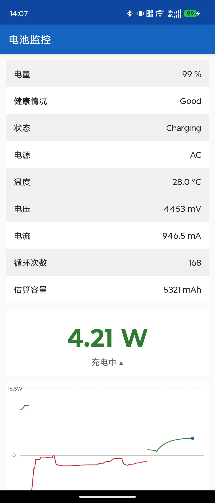
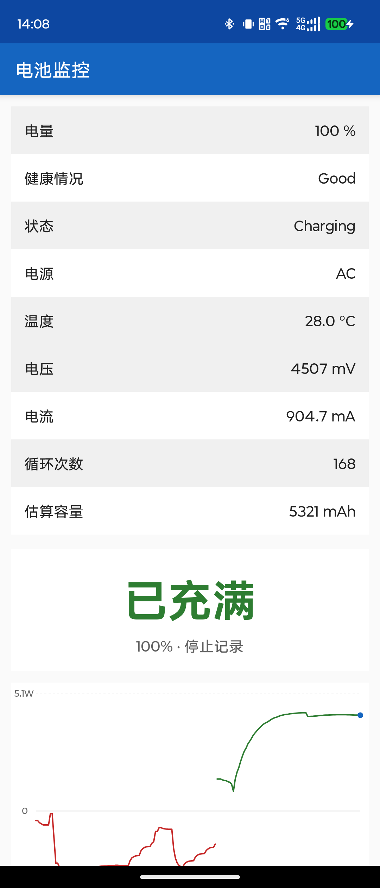
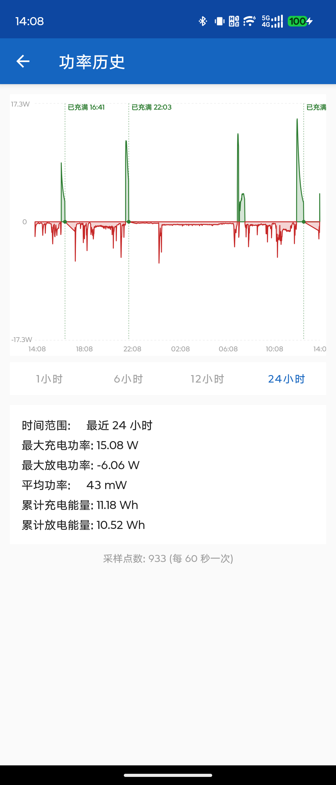

# BatteryMonitor · 安卓电池实时功率监控

**版本: v1.0.9**

轻量无广告的电池监控工具，参考 Device Info HW 电池页，额外加入实时功率大字和功率历史曲线。

## 界面预览

| 充电实时功率 | 100% 已充满 | 历史曲线（含充满标记） |
| :---: | :---: | :---: |
|  |  |  |

## 功能

**主界面**
- 电量、健康、状态、电源
- 温度、电压、电流（优先 AVERAGE，EMA 指数平滑消除尖刺）
- 循环次数（从 `BATTERY_CHANGED` intent extra `android.os.extra.CYCLE_COUNT` 读取）
- 估算容量（`charge_counter / level%`，非出厂设计值）
- 实时功率大字（充电绿色 / 放电红色）
- 实时功率曲线（充放电方向切换时自动断开连线，不交叉叠加）
- 100% 电插着充电器时显示"已充满"，停止记录（避免 BMS topping charge 脉冲导致虚假高功率）

**历史页**（点击曲线进入）
- 默认显示最近 1 小时
- 可切换 1h / 6h / 12h / 24h
- 最大充/放电功率、平均功率、累计能量（Wh）
- 进入 100% 充电时在曲线上画绿色标记点 + 竖直虚线 + "已充满 HH:mm" 标注
- 标记只在"真的充过电"之后才写入，拔下再插上不会产生多余的已充满点；相邻 10 分钟内的重复标记不显示，标签重叠时自动避让
- 充满期间曲线断开不画线；拔掉充电器后从新状态直接起笔，不与充满前的点连线，避免出现大斜线

**后台采样**
- 前台服务每 60s 采样写入 SQLite
- 每次采样连续读 3 次取中位数，剔除传感器尖刺
- 100% 电插着充电器时跳过采样，仅写一条"已充满"标记点
- 自动清理 48h 前数据

## 技术

- Kotlin + 原生 Android，无第三方图表库（自定义 Canvas View）
- minSdk 26 / targetSdk 33
- 包名 `com.battery.monitor`
- 电流 EMA 平滑：`smoothed = old × 0.5 + new × 0.5`
- 充放电方向切换时自动重置 EMA
- 后台采样中位数滤波：3 次读数取中位值
- 充放电状态判断基于 `plugged != 0`（而非 `status == CHARGING`），兼容 100% 电时 status=FULL 的情况
- SQLite schema v2，新增 `marker` 字段记录特殊事件点（`full` 表示已充满）

## 目录结构

```
app/src/main/java/com/battery/monitor/
├── BatteryReader.kt       电池数据读取、电流 EMA 平滑、循环次数与估算容量
├── MainActivity.kt        主界面刷新、功率大字与状态提示
├── HistoryActivity.kt     历史页、时间范围切换、统计信息
├── PowerChartView.kt      实时功率曲线（方向切换断开连线）
├── HistoryChartView.kt    历史功率曲线（含"已充满"标记点）
├── SamplingService.kt     前台采样服务（60s + 中位数滤波）
└── db/BatteryDbHelper.kt  SQLite 存储
docs/screenshots/          界面截图
```

## 编译

```bash
./gradlew assembleDebug
# APK: app/build/outputs/apk/debug/app-debug.apk
```

## 说明

- 循环次数从厂商私有 intent extra 读取，部分 ROM 不提供时回退到 `BatteryManager` API
- 设计容量在无 root 普通 App 下无法从 sysfs 读取（SELinux 封锁），用 charge_counter/level 估算
- 功率公式: P(mW) = V(mV) × I(mA) / 1000
- 电流读数经 EMA 平滑，不做硬钳位，不影响快充大电流显示
- 后台采样用中位数滤波，避免息屏时传感器尖刺污染历史数据
- 100% 电插着充电器时 BMS 在做 topping charge 脉冲补电，电流传感器读数不可靠，此时停止记录功率曲线和历史数据，仅保留一个时间标记点
- `docs/screenshots/` 中为真机实拍截图（日常充电、100% 已充满、24 小时历史曲线）
